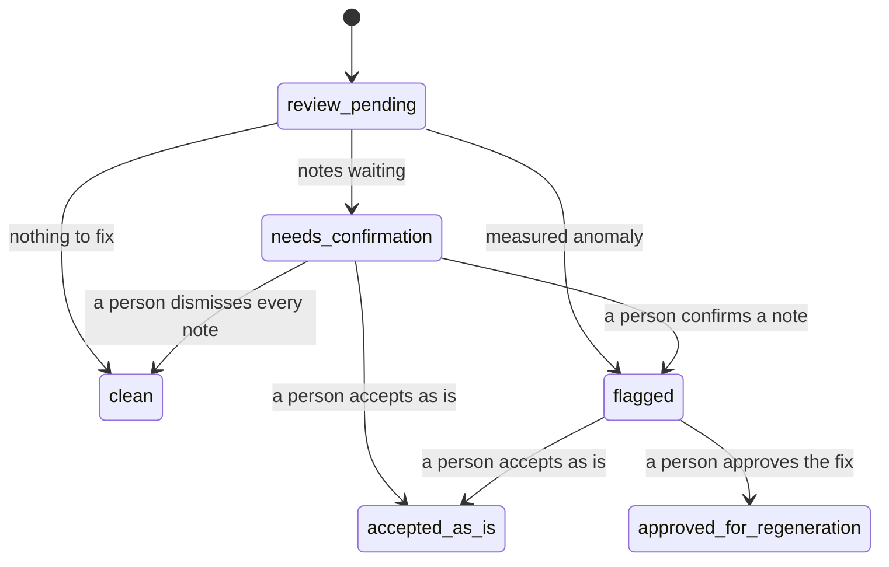

# ClearFrame contract

The names, file shapes and rules that all of ClearFrame's code follows. Change a name, field or rule only in a pull request that edits this file, and get a teammate to look before it merges.

Sample values (prompts, seeds, times, the threshold) are examples. The prompt hashes are real for the sample prompts.

## Shared names

These names appear unchanged in result files, SQLite, the rubric and the Slack card.

**Take IDs.** `<shot>-<take>`, as in `4-2`. A retake adds `r<n>`, counted per original take: the first retake of 4-2 is `4-2r1` (parent `4-2`), and a retake of that is `4-2r2` (parent `4-2r1`). The file name is the take ID (`4-2.mp4`, `4-2r1.mp4`). The fixed takes are `4-2r1` and `2-3r1`.

**Issue types.** One per check in `rubric/rubric.yaml`.

| Issue type | Found by | Card label | Planted in |
| --- | --- | --- | --- |
| `exposure_flicker` | Code, as a measured anomaly | exposure | None: a background check on every take |
| `road_markings` | The reviewer model, as a candidate note | road markings | 4-2 |
| `extra_finger` | The reviewer model, as a candidate note (fallback only) | extra finger | 2-3 |

**Folders.** Create the host folders before onboarding, because mounts are fixed then. NemoClaw mounts all of `~/clearframe/` read-only.

| Path | Holds | Written by |
| --- | --- | --- |
| `~/clearframe-input/takes/` (host) | The prepared takes and the fixed takes, waiting | Prep |
| `~/clearframe-input/renders/` (host) | Takes that have arrived: copy one in from `takes/` | The studio (you, in the demo) |
| `~/clearframe-input/shot_list.csv` (host) | `shot`, `description`, `expected_takes` | Prep |
| `~/clearframe-input/generation_log.csv` (host) | `take_id`, `shot`, `tool`, `model`, `seed` (as the tool reports it), `prompt` | Prep |
| `~/clearframe/app/` (host) | This repo, including `rubric/rubric.yaml` | `git pull` |
| `~/clearframe/results/` (host) | Result files and evidence frames | The worker only |
| `/sandbox/clearframe/host/` | `~/clearframe/` mounted read-only, so `app/` and `results/` | Nobody |
| `/sandbox/clearframe/state/clearframe.db` | SQLite | The sandbox app only |
| `/sandbox/clearframe/approved_generation_queue/` | Queue files | The approval code only |

**Evidence page.** Port 8090 inside the sandbox, forwarded to `http://127.0.0.1:8090` on the GB10 with `openshell forward`. Two pages: `/shot/<shot>` and `/take/<take_id>`. If 8090 is taken, change it here.

**Times, hashes, frames.** Times are ISO 8601 with the offset, as in `2026-10-25T13:41:07-07:00`. A hash is `sha256:` plus 64 hex characters, taken over the exact UTF-8 bytes. Frame numbers start at 0 and are the source of truth; seconds = frame ÷ fps, rounded to 3 decimals.

## The result file

The worker writes one JSON file per take to `results/<take_id>.json`. With its evidence frames, it is the only take data that crosses from the host into the sandbox.

**The worker reads** the render in `renders/`, the take's row in `generation_log.csv`, its shot's row in `shot_list.csv`, and the enabled checks and flicker threshold in `rubric/rubric.yaml`.

**Sample:** take 4-2's final revision is [`samples/result-4-2.json`](samples/result-4-2.json).

**A measured anomaly.** One entry in a take's `measured` list looks like this. Take 4-5 is only the example: no flicker is added to any take.

```json
{
  "issue_type": "exposure_flicker",
  "frame_start": 61,
  "frame_end": 63,
  "t_start": 2.542,
  "t_end": 2.625,
  "value": 18.4,
  "threshold": 8.0,
  "unit": "mean brightness change between consecutive frames, 0-255",
  "evidence": [
    "frames/4-5/000060.jpg",
    "frames/4-5/000061.jpg",
    "frames/4-5/000062.jpg",
    "frames/4-5/000063.jpg"
  ]
}
```

**Flicker is a spike that returns.** Brightness jumps past the threshold and comes back within `flicker_return_frames` frames, set in `rubric/rubric.yaml`. A change that stays, like a cut or the car driving into shadow, is not flicker and is not reported.

| Field | Meaning |
| --- | --- |
| `schema` | `clearframe.result/1`. Raise the number on any breaking change. |
| `take_id`, `parent_take_id`, `shot` | Taken from the file name. `parent_take_id` is set only for retakes. |
| `expected_takes` | Copied from `shot_list.csv`. |
| `revision`, `written_at` | 1 at pick-up, plus 1 on each rewrite; the time of this revision. |
| `worker_commit` | The git commit the worker ran, for the audit trail. |
| `render` | The file reviewed: name, hash, fps, frame count, size. |
| `generation` | Copied from `generation_log.csv`. The prompt becomes prompt version 1. The seed is the one the tool reports, when it reports one. |
| `checks` | Every enabled check: `running`, `done` or `error`. |
| `measured` | Code's anomalies: frames, seconds, value, threshold, unit, evidence. |
| `candidates` | The reviewer's notes: which pass, frames, seconds, the model's own words, evidence. `sparse` is the pass over the whole take; `dense` is consecutive frames plus a road crop around any moment code flagged or the sparse pass noted. |
| `brightness_series` | A JSON list of mean brightness per frame (0–255), for the evidence page's plot. |
| `vision` | The vision model's name, frames sent per pass, seconds spent. These feed the closing numbers. |
| `errors` | One short fixed message per failed check, never model output. |

**Write rules**

1. Write `<take_id>.json.tmp` in the same folder, then rename it to `<take_id>.json`. The sandbox skips `.tmp` files, so it never reads half a file.
2. Write the evidence frames and the brightness series before the JSON that points to them.
3. Write revision 1, with every check `running`, when the take is picked up. Write the final revision when every check is `done` or `error`.
4. Paths inside the file are relative to `results/`. Frame images are named by their six-digit frame number.
5. Keep only evidence frames and the brightness series in `results/`, not every extracted frame.

## Statuses

Code recomputes a take's status after every ingest and every decision, from its checks, issues and decisions. No person or model sets it directly.



An approved take's retake arrives as a new take (`4-2r1`), linked to its parent, and starts at `review_pending`.

**The rule (first match wins)**

1. Any check is still `running` or ended in `error` → `review_pending`.
2. A decision is recorded → `accepted_as_is` or `approved_for_regeneration`.
3. Any measured anomaly, or any confirmed note → `flagged`.
4. Any candidate note not yet confirmed or dismissed → `needs_confirmation`.
5. Otherwise → `clean`.

So `clean` means every enabled check finished, with no measured anomalies, no notes waiting and no confirmed issues. A dismissed note doesn't block it.

**What people can do (on the evidence page only)**

- Confirm or dismiss a candidate note, while the take is `needs_confirmation` or `flagged`.
- Accept as is, from `flagged` or `needs_confirmation`.
- Approve regeneration, from `flagged`, once no note is waiting and a fixed prompt version exists.
- Decisions are final: there is no undo. A retake starts a new take with its own status.

## SQLite tables

One file, `/sandbox/clearframe/state/clearframe.db`, written only by the sandbox app. It holds five tables. No row is ever deleted, and `events` is append-only.

**takes**

| Column | Type | Meaning |
| --- | --- | --- |
| `take_id` | text, key | `4-2`, `4-2r1` |
| `parent_take_id` | text, empty for originals | `4-2` for `4-2r1` |
| `shot` | integer | `4` |
| `expected_takes` | integer | From the result file |
| `status` | text | One of the six statuses |
| `result_revision` | integer | Highest revision ingested |
| `render_sha256` | text | Hash of the file reviewed |
| `fps`, `frames` | integer | For seconds and the plot |
| `brightness_series` | text | Path under `results/` |
| `first_seen_at`, `updated_at` | text | Times |

**issues**

| Column | Type | Meaning |
| --- | --- | --- |
| `issue_id` | text, key | Take ID plus a counter: `4-2-1` |
| `take_id` | text | The take |
| `issue_type` | text | `exposure_flicker`, `road_markings` or `extra_finger` |
| `state` | text | `measured` (code found it), `candidate` (the model noted it, waiting), `confirmed` or `dismissed` |
| `frame_start`, `frame_end` | integer | Frame positions |
| `t_start`, `t_end` | real | Seconds |
| `value`, `threshold` | real, empty for notes | Measured anomalies only |
| `model_note` | text, empty when measured | The model's words, shown on the evidence page only |
| `evidence` | text | JSON list of paths under `results/` |
| `decided_by`, `decided_at` | text | Who confirmed or dismissed it, and when |

**prompt_versions** (key: `take_id` and `version`)

| Column | Type | Meaning |
| --- | --- | --- |
| `take_id` | text | The take |
| `version` | integer | 1 is the generation log's prompt; 2 and up add fixes |
| `prompt` | text | The full text |
| `prompt_hash` | text | `sha256:` of the exact text |
| `fixes` | text | JSON list of the issue types appended, in rubric order; `[]` for version 1 |
| `created_at` | text | Time |

**approvals**

| Column | Type | Meaning |
| --- | --- | --- |
| `approval_id` | integer, key | Counter |
| `take_id` | text | The take |
| `decision` | text | `approved_for_regeneration` or `accepted_as_is` |
| `prompt_version`, `prompt_hash` | integer and text, empty for accept | What the page showed when the approver clicked |
| `approver` | text | A name from `approvers` in the rubric |
| `decided_at` | text | Time |
| `queue_file`, `next_take_id` | text, empty for accept | `4-2-v2.json`, `4-2r1` |

**events**

| Column | Type | Meaning |
| --- | --- | --- |
| `event_id` | integer, key | Counter |
| `at` | text | Time |
| `actor` | text | `worker`, `automation`, `prompt-fix` or a person's name |
| `kind` | text | One of the kinds below |
| `take_id`, `shot` | text and integer, either can be empty | What it's about |
| `detail` | text | Small JSON: old and new status, counts, the Slack message `ts`. No prompt text, no model notes. |

Event kinds: `take_seen`, `result_ingested`, `check_error`, `status_changed`, `card_posted`, `note_confirmed`, `note_dismissed`, `prompt_version_added`, `approval_refused`, `approved`, `accepted_as_is`, `queued`, `retake_linked`.

**Ingest rules (the automation)**

1. Read `results/*.json`. Skip `.tmp` files and any file whose `revision` isn't above `takes.result_revision`.
2. A new take ID: insert it as `review_pending` and log `take_seen`.
3. The first final revision: insert its issues and prompt version 1, log `result_ingested` (and `check_error` for each check that ended in error), then recompute the status. A take's issues are written once.
4. During development, rerunning a take means moving `clearframe.db` aside and letting the automation rebuild it from the result files.
5. Post a shot's card once, when every expected original take has a final result. Post a retake's card when its own result is final. Each post logs `card_posted`.

## Slack card

Code builds every card from a fixed template, using only the fields below. No prompt, model text, frame or file name reaches Slack.

**When it posts**

- **Shot card:** once, when every expected original take of the shot has a final result.
- **Retake card:** once, when a retake's result is final.

**Fields**

| Field | Sample | From |
| --- | --- | --- |
| Shot | Shot 4 | `takes.shot` |
| Reviewed | 6 of 6 takes | Final originals out of `expected_takes` |
| Take ID | 4-2 | `takes.take_id` |
| Status | needs confirmation | `takes.status`, as its label |
| Counts by category | 1 candidate note (road markings) | `issues`, counted by state and issue type |
| Clean takes | 4-1, 4-3, 4-4, 4-6 | Takes whose status is `clean` |
| Retake of | 4-2 | `takes.parent_take_id` (retake card only) |
| Link | `http://127.0.0.1:8090/shot/4` | The evidence page |

**Samples** (default wording; the final wording lives in `rubric/`). The takes and results shown are examples.

```text
ClearFrame · Shot 4 · 6 of 6 takes reviewed
4-2: needs confirmation · 1 candidate note (road markings)
4-5: flagged · 1 measured anomaly (exposure)
Clean: 4-1, 4-3, 4-4, 4-6
Evidence, on the GB10: http://127.0.0.1:8090/shot/4
```

```text
ClearFrame · Retake 4-2r1 of 4-2 · clean
Evidence, on the GB10: http://127.0.0.1:8090/take/4-2r1
```

**Labels**

| Value | Label on the card |
| --- | --- |
| `review_pending` | reviewing |
| `needs_confirmation` | needs confirmation |
| `flagged` | flagged |
| `clean` | clean |
| `accepted_as_is` | accepted as is |
| `approved_for_regeneration` | approved for regeneration |
| Issue state `measured` | measured anomaly |
| Issue state `candidate` | candidate note |
| Issue state `confirmed` | confirmed note |
| A check in `error` | check error (category), shown in place of the status |

Category labels are in the issue-types table under "Shared names". Dismissed notes aren't counted.

**Never on a card:** prompts or diffs, the model's words, frames or thumbnails, brand, product or shot descriptions, approver names, and any path except the link. The smoke test checks a real card's payload against this field list.

## Approval and the queue file

Approval happens only on the evidence page. It is bound to the take ID, prompt version, prompt hash, approver and time. The queue writer refuses it if the prompt changed after the page showed it.

**prompt-fix (code, no model).** When a take becomes `flagged`, code adds the next prompt version:

- Start from version 1, add a blank line, then the fix lines for each measured or confirmed issue type, once per type, in rubric order.
- Each type's lines come from the fix library, one line per label, in the order Don't include, Add, Make sure. Join lines with a single newline; no trailing newline.
- Skip a fix line that version 1 already contains, so a retake that fails again doesn't repeat it. If every line is already there, no version is added, and the take can only be accepted as is.
- A note confirmed later adds another version, built the same way. The evidence page always shows the latest.

Fixed takes must be generated from exactly this text. For the sample, version 2 is:

```text
The Vela drives down a city street at golden hour, tracking shot, lane arrows painted on the road.

Make sure: lane arrows point in the direction of travel and lane lines stay continuous.
```

Version 1's hash is `sha256:ee4aa7f4a4c28994d974159b541e8f8b372c29b03ade2ad7098b62c6ee08b89d`. Version 2's is `sha256:08e2b485acb99acac2ef6705b87465634da1c9a1c66d86c816d1ba1b07cf1ed6`.

**The four actions.** The evidence page calls these and never writes SQLite itself.

| Action | The page sends | Allowed when | Writes |
| --- | --- | --- | --- |
| Confirm note | `issue_id`, `approver` | The note is `candidate` | `state` = `confirmed`; `note_confirmed` |
| Dismiss note | `issue_id`, `approver` | The note is `candidate` | `state` = `dismissed`; `note_dismissed` |
| Accept as is | `take_id`, `approver` | The take is `flagged` or `needs_confirmation` | An approvals row; `accepted_as_is` |
| Approve regeneration | `take_id`, `prompt_version`, `prompt_hash`, `approver` | The take is `flagged`, no note is waiting, and it has a version above 1 | An approvals row and the queue file; `approved`, `queued` |

**Checks before a queue file is written.** Any failure refuses the approval, shows the reason and logs `approval_refused`.

1. `approver` is listed under `approvers` in `rubric.yaml`. The page opens only on the GB10's own screen, so physical access to the box is today's login.
2. The take is `flagged`, no note is waiting, and it has a version above 1.
3. `prompt_version` is the take's latest version, and `prompt_hash` equals its stored hash.
4. The hash recomputed from the stored text still matches.

**Sample queue file:** [`samples/queue-4-2-v2.json`](samples/queue-4-2-v2.json), written as `approved_generation_queue/4-2-v2.json`. Its `schema` is `clearframe.queue/1`; raise the number on any breaking change.

**Queue rules**

- One file per approval, named `<request_id>.json`, where `request_id` is `<take_id>-v<version>`. Write it as `.tmp`, rename it, and never change it.
- `next_take_id` numbers retakes per original take: 4-2's first retake is `4-2r1`. If `4-2r1` is approved in turn, its retake is `4-2r2`, with parent `4-2r1`.
- `generation` repeats the parent's tool and model, and its seed only when the tool takes one. Seedance 2.0 on fal doesn't take a seed, so there the queue file's seed is null and the retake gets a new one.
- The returned render must be named `next_take_id` and carry the queued prompt in `generation_log.csv`. When its result arrives, code compares its prompt hash with the approval's and logs `retake_linked` with the match. Either way, it is reviewed as a new take.
- ClearFrame never generates the retake. In the demo, a fixed take made in prep, or one of Blake's good renders introduced as such, plays the returned render.
